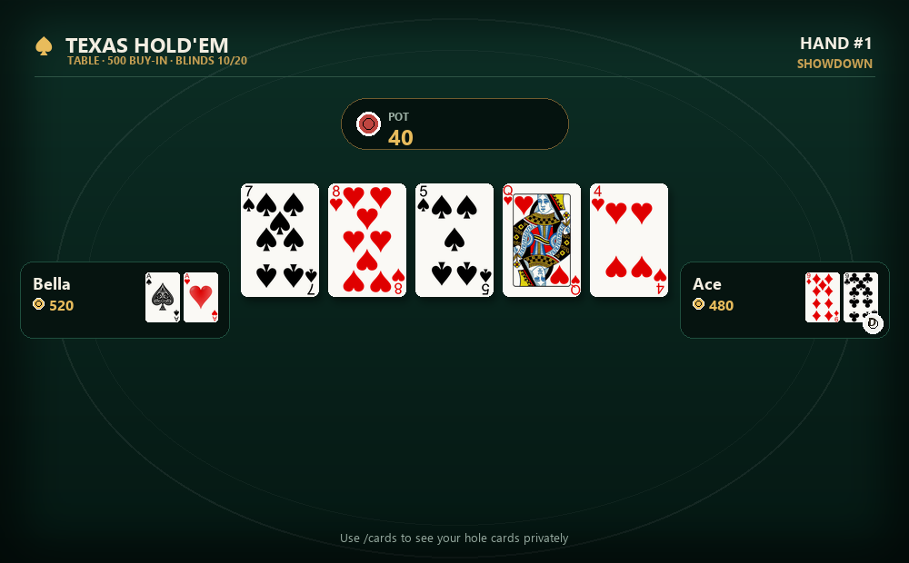
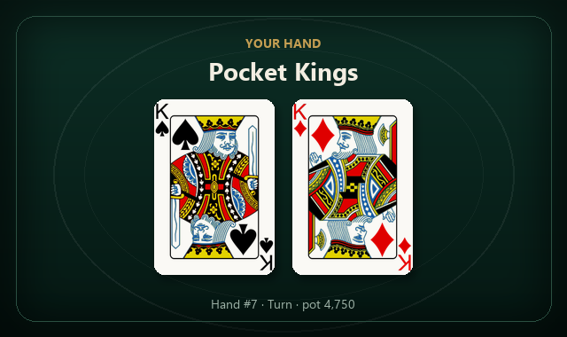

# ♠ Discord Texas Hold'em Bot

A Python Discord bot for no-limit Texas Hold'em with persistent chip wallets, daily rewards, real card artwork, private hole cards, turn timers, and proper side-pot handling.



## Features

- **`/daily`** — claim **1,000** chips once per UTC day.
- **`/creategame [buy_in]`** — opens a table in the channel and joins the host automatically. The buy-in (default **500**) becomes the host's starting stack.
- **`join game`** — typed in the channel, or use the **Join game** button. Does nothing if no table exists.
- **`start game`** — the host starts the game by typing this or pressing **Start game**.
- **Full no-limit Hold'em** — blinds, four betting rounds, all-ins, side pots, split pots, min-raise rules, and showdowns are handled by [PokerKit](https://github.com/uoftcprg/pokerkit).
- **Private cards** — hole cards are sent by DM when each hand starts. `/cards` shows them again, ephemerally, along with your current best hand.
- **Public table** — a rendered table image shows stacks, bets, the button, community cards, pot, folded/removed players, and hole cards only at showdown.
- **Turn timer** — each player has **60 seconds**. Missing the deadline auto-folds.
- **Timeout removal** — after more than **3** timeouts (the 4th), the player is removed from the table and their remaining stack is forfeited to the pot.
- **`/endgame`** — the host or a server admin closes the table immediately. Remaining stacks are cashed back into wallets.
- **Chip wallet** — SQLite balances survive bot restarts.
- **Crypto RNG** — the deck is shuffled with `secrets.SystemRandom`, and PokerKit draws from that single shuffled deck (so burn cards never duplicate dealt cards).


## Setup

Requires **Python 3.11+**.

1. Create and activate a virtual environment, then install dependencies:

   ```bash
   python -m venv .venv
   # Windows:
   .venv/Scripts/activate
   # macOS / Linux:
   source .venv/bin/activate
   pip install -r requirements.txt
   ```

2. Create a bot at the [Discord Developer Portal](https://discord.com/developers/applications):
   - Open **Bot** and reset/copy the token.
   - Enable **Message Content Intent** under **Privileged Gateway Intents**. This is required for the typed `join game` / `start game` commands.
   - Invite it with the `bot` and `applications.commands` scopes and these permissions: **View Channels**, **Send Messages**, **Embed Links**, **Attach Files**, **Read Message History**.
   - Users need **DMs from server members** enabled to receive hole cards; `/cards` works as a private fallback.

3. Configure environment variables:

   ```bash
   cp .env.example .env
   # edit .env and paste DISCORD_TOKEN=...
   ```

   For instant slash-command updates while developing, set `GUILD_ID` in `.env` to your server ID. Otherwise commands sync globally (Discord can take a while to show them).

4. Run the bot from the project root:

   ```bash
   python -m pokerbot
   ```

5. In a server channel:

   ```
   /daily
   /creategame
   join game
   start game
   ```

## Commands

| Command | Who | What it does |
| --- | --- | --- |
| `/daily` | everyone | Claims 1,000 chips once per UTC day and shows your balance. |
| `/help` | everyone | Rules, command list, and a generated hand-ranking chart. |
| `/creategame [buy_in]` | everyone | Opens a table. Buy-in range is 100–100,000; default 500. One table per channel. |
| `join game` (typed) | everyone | Joins the lobby. Requires enough chips; the buy-in is deducted. |
| `start game` (typed) | host | Starts the game. Also available as the **Start game** button. |
| Buttons | players in hand | Fold, Check/Call, Raise (opens a modal), All-in. |
| `/cards` | players in hand | Ephemeral view of your hole cards and current best five-card hand. |
| `/endgame` | host or admin | Immediately closes the table and cashes out remaining stacks. |

## Rules in brief

- Each player starts with a stack equal to the buy-in. Blinds scale with the buy-in: `small = buy_in / 50`, `big = 2 × small` (500 → 10/20).
- Two hole cards each; five community cards are dealt as the flop (3), turn (1), and river (1).
- Betting rounds: pre-flop, flop, turn, river. No-limit; a raise must be at least the big blind or the previous raise.
- All-in bets and side pots are resolved automatically.
- Hands continue until one player has chips left or the host/admin runs `/endgame`. Busting a buy-in means the chips are lost; cashing out returns your remaining stack to your wallet.
- The buy-in is taken when you join, and remaining chips are credited back when the table closes. If the bot is shut down gracefully, active tables are cashed out.

### Timeouts

Every turn has a **60-second** limit. If you do not act:

1. Your hand is auto-folded.
2. The timeout is recorded for the rest of that game.
3. On timeout **4** (more than 3), you are removed from the table. Your remaining stack is added to the pot as dead money; the current hand's winner receives it.

## Help artwork

`/help` includes this generated chart:


Private hole-card view:



## Project layout

```
pokerbot/
  bot.py        Discord client, setup hook, graceful shutdown cash-out
  cog.py        /daily, /help, /creategame, /endgame, /cards, typed join/start
  game.py       table orchestration, timers, timeouts, embeds, cashier
  engine.py     poker rules wrapper, seating/blinds rotation, CSPRNG-shuffled deck
  ui.py         lobby/action buttons and raise modal
  visuals.py    Pillow table, hole-card, and hand-ranking renders
  store.py      SQLite chip wallet
assets/cards/   MIT-licensed playing card PNGs + LICENSE
tests/          engine, wallet, and headless game-loop tests
```

## Tests

```bash
python -m unittest discover -s tests -v
```

The suite covers deck determinism, heads-up blinds/action order, raise validation, all-in side-pot chip conservation, showdown reveals, timeout forfeiture, daily/debit/credit behavior, and the full Discord game loop with fake Discord objects.

## Credits

- Poker rules and hand evaluation: [PokerKit](https://github.com/uoftcprg/pokerkit) (MIT).
- Card faces: [playing-cards-assets](https://github.com/hayeah/playing-cards-assets) (MIT, from public-domain vector playing cards). See `assets/cards/LICENSE`.
- Discord API: [discord.py](https://github.com/Rapptz/discord.py).
- Image rendering: [Pillow](https://python-pillow.org/).

Chips are play money only.
