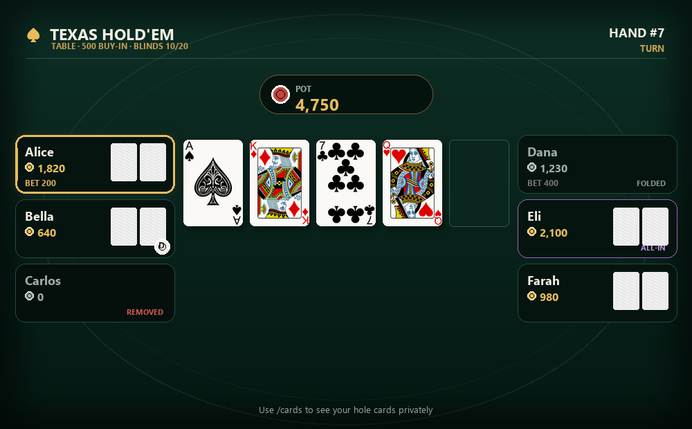
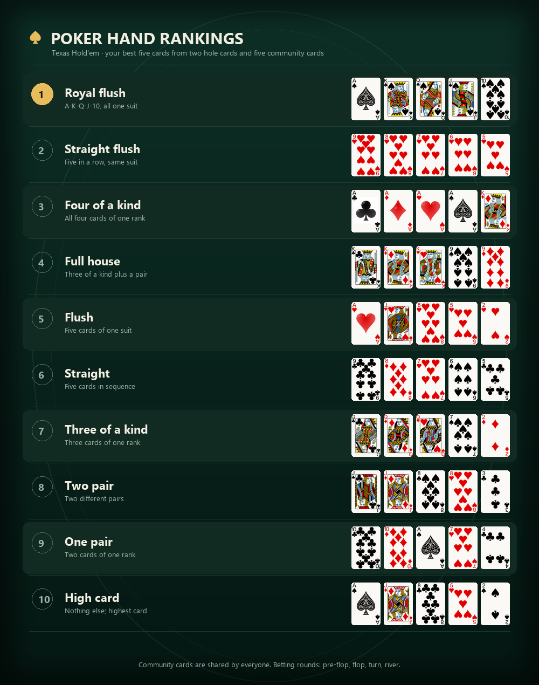

# ♠ Discord Texas Hold'em Bot

A Python Discord bot for no-limit Texas Hold'em with persistent chip wallets, daily rewards, real card artwork, private hole cards, turn timers, and proper side-pot handling.


## Features

- **`/profile [user]`** — view your own or another player's avatar, username, wallet, daily availability/cooldown, and poker progress: games played, hands played, hands won, hand win rate, biggest pot won, and net chips.
- **`/daily`** — claim **1,000** chips every 24 hours.
- **`/balance [user]`** — check how many chips you have, or another player's.
- **`/hands`** — see every poker hand from royal flush down to high card, with examples, what each hand beats, tie/kicker rules, and the hand-ranking chart. Every game start posts an enlarged copy of the chart in the channel.
- **`/howtoplay`** — a beginner-friendly guide to Texas Hold'em: the objective, the deal and betting rounds, what check/call/raise/all-in/fold do, blinds and the dealer button, pots and side pots, and how to win. Includes the hand-ranking chart and points to `/hands` for full hand details.
- **`/help`** — bot help: quick-start steps, the full command list, chip handling, in-hand controls, and the turn timer.
- **`/creategame [buy_in] [hands]`** — opens a table in the channel and joins the host automatically. The buy-in (default **500**) becomes the host's starting stack. Set `hands` to close the table after that many hands (default is unlimited).
- **`join game`** — typed in the channel, or use the **Join game** button. Does nothing if no table exists.
- **`start game`** — the host starts the game by typing this or pressing **Start game**.
- **Full no-limit Hold'em** — blinds, four betting rounds, all-ins, side pots, split pots, min-raise rules, and showdowns are handled by [PokerKit](https://github.com/uoftcprg/pokerkit).
- **Chat actions** — during your turn, type exactly `check`, `call`, `raise <amount>`, `all in`, or `fold` in the channel. Partial messages such as `call now` are ignored. The action buttons still work.
- **Private refusals** — errors that only concern you (not your turn, not enough chips to join, not the host) are ephemeral when triggered from a button or slash command, and sent by DM when triggered by a chat command, with a ❌ on your message. The bot only falls back to a channel reply if your DMs are closed. `/daily` replies are ephemeral too, so personal wallet details never push the table up.
- **Private cards** — a **View my cards** button sits on the table message, so no extra message is posted below the table. Pressing it (or using `/cards`) shows your hole cards and current best hand in an ephemeral reply that only you can see. No DMs required. All other bot messages are public by default.
- **Public table** — a rendered table image shows stacks, bets, the button, community cards, pot, folded/removed players, and hole cards only at showdown. The embed above it shows the pot, blinds, the current board, the player on the clock with their call and raise options, and a running log of every action in the hand. Action confirmations are private, and whenever newer messages would push the table up, it is re-posted at the bottom of the channel so the live table is always the last thing on screen.
- **Turn timer** — each player has **60 seconds**. Missing the deadline auto-folds.
- **Timeout removal** — after more than **3** timeouts (the 4th), the player is removed from the table and their remaining stack is forfeited to the pot.
- **`/endgame`** — the host or a server admin closes the table immediately. Remaining stacks are cashed back into wallets.
- **Chip wallet** — balances are stored in PostgreSQL via `DATABASE_URL` and survive bot restarts.
- **Crypto RNG** — the deck is shuffled with `secrets.SystemRandom`, and PokerKit draws from that single shuffled deck (so burn cards never duplicate dealt cards).
- **Health endpoint** — `GET /health` on the port from `PORT` (default **8080**) answers `200` while the bot is connected to Discord and `503` while it is starting, reconnecting, or shutting down, so an uptime poller can tell a live bot from a stuck one. It is intentionally never rate limited.
- **Bot profile** — the bot shows `Dealing cards | /help` as its status, and its slash commands are registered globally so Discord lists them in the profile's **Commands** tab.



## Setup

The bot needs a **Discord bot token** and a **PostgreSQL** database. Docker
Compose bundles both the bot and the database, so the quickest start needs only
[Docker](https://docs.docker.com/get-docker/) installed.

### 1. Create the Discord bot

Create an application at the [Discord Developer Portal](https://discord.com/developers/applications):

- Open **Bot** and reset/copy the token.
- Enable **Message Content Intent** under **Privileged Gateway Intents**. This is required for the typed `join game` / `start game` commands.
- Invite it with the `bot` and `applications.commands` scopes and these permissions: **View Channels**, **Send Messages**, **Embed Links**, **Attach Files**, **Read Message History**.

### 2. Run with Docker Compose (recommended)

The Compose file is set up for a **hosted/cloud PostgreSQL**: the bot reads
`DATABASE_URL` from `.env`, and the bundled database service is commented out.
If you prefer to run PostgreSQL in Docker instead, see
[Use a local PostgreSQL container](#use-a-local-postgresql-container-instead).

1. Create the environment file and add your token and database URL:

   ```bash
   cp .env.example .env
   # edit .env and set DISCORD_TOKEN=... and DATABASE_URL=postgresql://...
   ```

2. Start everything:

   ```bash
   docker compose up -d --build
   docker compose logs -f bot
   ```

   The first run builds the image (a minute or so). Later starts are quick:
   `docker compose up -d` brings the bot back in seconds. After pulling code
   changes, rebuild with `docker compose up -d --build`.

3. Stop it when you are done:

   ```bash
   docker compose down        # keeps local state
   docker compose down -v     # also deletes the saved state
   ```

   Stopping sends SIGTERM and gives the bot 30 seconds to cash out any open
   tables before it exits, so chips are never stranded. Wallets and stats live
   in your cloud database, so they are unaffected either way.

Local state is kept in the `pokerbot-data` volume (the slash-command sync
fingerprint, which avoids unnecessary global command syncs and keeps you clear
of Discord's rate limit).

#### Use a local PostgreSQL container instead

The `db` service and its volume are commented out in `docker-compose.yml`.
To switch to a PostgreSQL container running alongside the bot:

1. Uncomment the `db` service at the bottom of `docker-compose.yml`.
2. Uncomment the `depends_on` block in the `bot` service.
3. Uncomment `pokerbot-db` in the top-level `volumes` section.
4. Replace the bot's `DATABASE_URL` line with the internal URL shown in the
   comment there:

   ```yaml
   DATABASE_URL: postgresql://${POSTGRES_USER:-pokerbot}:${POSTGRES_PASSWORD:-pokerbot}@db:5432/${POSTGRES_DB:-pokerbot}
   ```

5. Optionally set `POSTGRES_USER`, `POSTGRES_PASSWORD`, and `POSTGRES_DB` in
   `.env` to override the defaults.

The cloud `DATABASE_URL` in `.env` is unused by the container once the internal
URL is in place. Wallets are then stored in the `pokerbot-db` volume, and
`docker compose down -v` deletes them.

### 3. Run locally (alternative)

Requires **Python 3.11+** and a **PostgreSQL** database.

```bash
python -m venv .venv
# Windows:
.venv/Scripts/activate
# macOS / Linux:
source .venv/bin/activate
pip install -r requirements.txt
cp .env.example .env
# edit .env and set DISCORD_TOKEN=... and DATABASE_URL=postgresql://...
python -m pokerbot
```

The bot creates its tables automatically on startup. Slash commands are synced
globally, which is what makes Discord list them in the bot's profile under
**Commands** (Discord can take a while to show global updates). For instant
command updates while developing, set `GUILD_ID` in `.env` to your server ID;
the bot then also registers a copy of the commands in that server. Global syncs
are only sent when the command set changes, because Discord rate limits them.

### 4. Try it in a server channel

```
/daily
/creategame
join game
start game
```

## Health check

The bot serves one small HTTP route for uptime monitors:

```
GET /health    (GET / is an alias)
```

| Bot state | Status | Example body |
| --- | --- | --- |
| Connected to Discord | `200` | `{"bot": "online", "guilds": 3, "tables": 1, "uptime_seconds": 42.7, "latency_ms": 53.2, "service": "pokerbot", "status": "ok"}` |
| Starting, reconnecting, or shutting down | `503` | `{"bot": "offline", ..., "status": "unavailable"}` |

- The port comes from `PORT` when the hosting platform injects one, otherwise `HEALTH_PORT`, otherwise **8080**. The server binds `HEALTH_HOST` (default `0.0.0.0`) so a platform router can reach it.
- Docker Compose passes `PORT` into the container, publishes `${PORT:-8080}:${PORT:-8080}`, and uses this route as the container healthcheck, so `docker compose ps` reports **healthy** once Discord connects.
- `HEAD` works too, query strings are ignored, other paths return `404`, and other methods return `405`.
- The route is deliberately **not rate limited**: pollers and orchestrators must be able to ask as often as they like without a `429`, which would otherwise look like an outage. Any future route should get a limiter; `/health` stays exempt.

```bash
curl -i "http://localhost:${PORT:-8080}/health"
```

## Commands

| Command | Who | What it does |
| --- | --- | --- |
| `/daily` | everyone | Claims 1,000 chips every 24 hours and shows your balance. |
| `/balance [user]` | everyone | Shows your chip balance, or another member's. |
| `/hands` | everyone | Lists every hand from strongest to weakest with example cards, what each hand beats, and the hand-ranking chart. Every game start posts an enlarged copy of the chart. |
| `/profile [user]` | everyone | Shows your profile, or another member's, including avatar, username, wallet, daily status/cooldown, and poker stats (games, hands, hand wins/rate, biggest pot, net chips). Public message. |
| `/help` | everyone | Bot help: quick start, command list, chips, in-hand controls, and the turn timer. |
| `/howtoplay` | everyone | Poker guide: objective, deal and betting rounds, check/call/raise/all-in/fold, blinds, pots, and showdown. Includes the hand-ranking chart and points to `/hands` for detail. |
| `/creategame [buy_in] [hands]` | everyone | Opens a table. Buy-in range is 100–100,000; default 500. `hands` (1–1,000) closes the table after that many hands; omit it to play until one player is left. One table per channel. |
| `join game` (typed) | everyone | Joins the lobby. Requires enough chips; the buy-in is deducted. |
| `start game` (typed) | host | Starts the game. Also available as the **Start game** button. |
| `check` / `call` / `fold` (typed) | player whose turn it is | Acts in the hand. The whole message must match, ignoring case and surrounding spaces. |
| `all in`, `all-in`, or `allin` (typed) | player whose turn it is | Moves all-in. |
| `raise <amount>` or `bet <amount>` (typed) | player whose turn it is | Raises to the given total (commas allowed). `raise to <amount>` also works. |
| Buttons | players in hand | Fold, Check/Call, Raise (opens a modal), All-in. |
| **View my cards** | players in hand | Opens an ephemeral, user-only view of your hole cards and current best hand. |
| `/cards` | players in hand | Same private view, available at any time during a hand. |
| `/endgame` | host or admin | Immediately closes the table and cashes out remaining stacks. |

## Rules in brief

For a beginner-friendly walkthrough, use `/howtoplay`. For every hand ranked strongest to weakest, use `/hands`.

- Each player starts with a stack equal to the buy-in. Blinds scale with the buy-in: `small = buy_in / 50`, `big = 2 × small` (500 → 10/20).
- Two hole cards each; five community cards are dealt as the flop (3), turn (1), and river (1).
- Betting rounds: pre-flop, flop, turn, river. No-limit; a raise must be at least the big blind or the previous raise.
- All-in bets and side pots are resolved automatically.
- Hands continue until one player has chips left, a set `hands` limit is reached, or the host/admin runs `/endgame`. Busting a buy-in means the chips are lost; cashing out returns your remaining stack to your wallet.
- The buy-in is taken when you join, and remaining chips are credited back when the table closes. If the bot is shut down gracefully, active tables are cashed out.

### Timeouts

Every turn has a **60-second** limit. If you do not act:

1. Your hand is auto-folded.
2. The timeout is recorded for the rest of that game.
3. On timeout **4** (more than 3), you are removed from the table. Your remaining stack is added to the pot as dead money; the current hand's winner receives it.

## Help artwork

`/howtoplay` includes this generated chart (and `/hands` shows it alongside the full hand detail):



Private hole-card view:


## Recorded players and servers

The bot keeps an audience log in the same PostgreSQL database; the tables are
created automatically on startup.

| Table | Columns |
| --- | --- |
| `users` | `user_id`, `chips`, `last_daily`, `username`, `display_name`, `added_at`, `updated_at` |
| `discord_guilds` | `guild_id`, `name`, `added_at`, `removed_at` |
| `guild_events` | `id`, `guild_id`, `name`, `event` (`added`/`removed`), `occurred_at` |

- A player's name is stored on their wallet row in `users` the first time they
  use a command or act in a hand, and refreshed at most once an hour.
- `/daily` uses a rolling 24-hour cooldown stored in `users.last_daily`: each
  successful claim sets the timer back to 24 hours, so the reset time follows
  the player instead of a fixed UTC day boundary.
- A server is recorded when the bot joins it. The list is reconciled on every
  reconnect, so servers the bot was kicked from while it was offline are still
  marked. `added_at` is the start of the current tenure and `removed_at` is
  `NULL` while the bot is in the server.
- `guild_events` is an append-only history, so an earlier kick is still visible
  after the bot is re-added.

```sql
SELECT user_id, username, display_name, added_at FROM users ORDER BY added_at;
SELECT * FROM discord_guilds ORDER BY added_at;
SELECT * FROM guild_events   ORDER BY occurred_at;
```

## Project layout

```
pokerbot/
  bot.py        Discord client, setup hook, graceful shutdown cash-out
  cog.py        /daily, /balance, /hands, /profile, /help, /howtoplay, /creategame, /endgame, /cards
  game.py       table orchestration, timers, timeouts, embeds, cashier
  engine.py     poker rules wrapper, seating/blinds rotation, CSPRNG-shuffled deck
  hands.py      hand-ranking embed used by /hands
  health.py     GET /health endpoint for uptime pollers
  ui.py         lobby/action buttons and raise modal
  visuals.py    Pillow table, hole-card, and hand-ranking renders
  store.py      PostgreSQL chip wallet, poker stats, player/server tracking
assets/cards/   MIT-licensed playing card PNGs + LICENSE
tests/          engine, wallet, and headless game-loop tests
Dockerfile      bot image (Python 3.12 slim, non-root, SIGTERM-aware)
docker-compose.yml
                bot service; optional PostgreSQL block is commented out
.dockerignore   keeps the build context small and .env out of the image
```

## Tests

```bash
python -m unittest discover -s tests -v
```

The store tests need `DATABASE_URL` (or `TEST_DATABASE_URL`) pointing at PostgreSQL; they create and drop an isolated temporary schema. They are skipped when no database is configured. The suite covers deck determinism, heads-up blinds/action order, raise validation, all-in side-pot chip conservation, showdown reveals, timeout forfeiture, daily/debit/credit behavior, and the full Discord game loop with fake Discord objects.

To run the suite in the bot image against the database configured in `.env`
(your cloud database, or the bundled container if you enabled it), mount the
test folder into the image:

```bash
docker compose run --rm --build -v "${PWD}/tests:/app/tests" bot \
  python -m unittest discover -s tests -v
```

## Credits

- Poker rules and hand evaluation: [PokerKit](https://github.com/uoftcprg/pokerkit) (MIT).
- Card faces: [playing-cards-assets](https://github.com/hayeah/playing-cards-assets) (MIT, from public-domain vector playing cards). See `assets/cards/LICENSE`.
- Discord API: [discord.py](https://github.com/Rapptz/discord.py).
- Image rendering: [Pillow](https://python-pillow.org/).

Chips are play money only.
